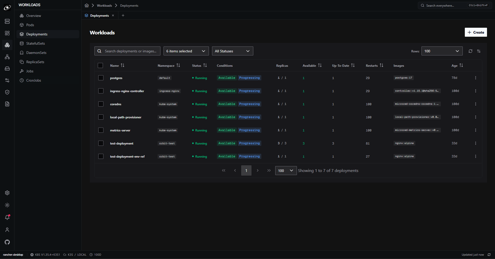

# Orbit 🛰️

<p align="center">
  <strong>A lightweight, native Kubernetes desktop dashboard built with Rust, Tauri v2, and an experimental GPUI native shell.</strong>
</p>

<p align="center">
  <a href="https://github.com/vantoan1511/orbit/releases"></a>
  <a href="LICENSE"></a>
  <a href="https://www.rust-lang.org/"></a>
  <a href="https://tauri.app/"></a>
  <a href="https://vuejs.org/"></a>
  <a href="https://primevue.org/"></a>
  <a href="https://www.gpui.rs/"></a>
</p>

---

Desktop Kubernetes management shouldn't require running a dedicated Chromium instance consuming 1–2 GB of RAM just to check a Pod status or inspect an ingress rule.

**Orbit** is built for engineers who want a snappy, native-feeling desktop experience without the Electron overhead. By pairing a shared **Rust core engine (`orbit-core`)** with **Tauri v2** (using your OS's native webview)—alongside an **opt-in native GPUI desktop shell (`orbit-gpui`)**—Orbit starts quickly, sips memory, and keeps cluster operations isolated and fast.

<p align="center">
  
  <br />
  <em>Fast, compact, and designed for day-to-day cluster navigation.</em>
</p>

---

## ⚡ Why Orbit?

- **Compiled Rust Core**: High-throughput Kubernetes communication, real-time watchers, streaming log parsers, and batch resource fetching run in native Rust via `kube-rs` and `tokio`.
- **Zero Electron Overhead**: Built on [Tauri v2](https://tauri.app/) using your operating system's native webview—plus an experimental pure-Rust [GPUI](https://www.gpui.rs/) desktop shell for even lower overhead.
- **Security by Isolation**: Kubeconfig credentials, certificates, and cluster tokens stay exclusively inside the local Rust process—never leaking into the frontend presentation layer.
- **IDE-Grade Density**: Technical, information-dense monochrome/noir interface with multi-tab workflows, customizable keyboard shortcuts, and 6 selectable UI style presets.

---

## ✨ Features

### ☸️ Context, Namespace & Multi-Tab Navigation

- **Instant Context Switching**: Jump between local clusters (Kind, k3s, Minikube) and remote cloud environments, with support for custom kubeconfig paths and per-cluster customizations.
- **Multi-Tab Workspace**: Open multiple resource views, detail drawers, YAML editors, and terminals in persistent IDE-style tabs.
- **Isolated Namespace Scoping**: Filter resources globally or inspect multiple namespaces with zero cross-cluster state bleed.
- **Global Search & Keyboard Shortcuts**: Quickly jump to resources and actions via global search and fully customizable keyboard shortcuts.
- **Connection Diagnostics**: Immediate visual feedback and offline recovery views when a cluster or control plane endpoint is degraded or unreachable.

### 📦 Comprehensive Resource Explorer

- **Cluster Overview & Metrics**: At-a-glance cluster health, resource counts, and metrics visualizations powered by Chart.js.
- **Workloads**: Inspect and manage Deployments, Pods, StatefulSets, DaemonSets, ReplicaSets, Jobs, CronJobs, and HorizontalPodAutoscalers (HPAs), including inline replica scaling and container image editing.
- **Configuration & Storage**: Inspect ConfigMaps, Secrets, PersistentVolumes, PersistentVolumeClaims, StorageClasses, and Storage Overview.
- **Network & Policies**: Audit Services, Ingresses, NetworkPolicies, ResourceQuotas, LimitRanges, and Pod Security.
- **Cluster Infrastructure**: Monitor Nodes with real-time watching and administration actions (`cordon`, `uncordon`, `drain`), plus Namespaces and cluster-wide Events.

### 💻 Integrated Terminal & Pod Exec

- **Interactive Pod Shell & Local Terminal**: Open interactive `exec` sessions inside running containers or launch local shell sessions directly in Orbit, powered by `xterm.js` and `portable-pty` with configurable default shell preferences.

### 📝 Integrated Monaco YAML Editor & Direct Apply

- **Live Manifest Editor**: Locally bundled Monaco Editor with YAML syntax highlighting and isolated draft lifecycles per tab.
- **Diff & In-App Apply**: Review changes and apply updates directly to the cluster with structured validation feedback and automatic conflict retry handling.

### 📊 Real-Time Logs & Cluster Events

- **Pod Log Streaming**: Follow live container output with multi-container switching, text filtering, syntax highlighting, and log downloads.
- **Event Timeline**: Stream and filter warnings, container crashes, and lifecycle events across namespaces in real time.

### 🔌 Persistent Port Forwarding

- **Background Tunnels**: Start and manage port-forwarding sessions directly from Pod or Service views; sessions persist cleanly across tab and view changes.

### 🎨 Appearance, Desktop Integration & Updates

- **Theme & UI Presets**: Switch between Light, Dark, and System themes, customize accent and semantic colors, and choose from 6 UI style presets (`Flat`, `Glass`, `Aero`, `Liquid Glass`, `iOS`, and `Paper`).
- **Desktop Integration**: System tray with optional close-to-tray behavior, launch on startup, HTTP/HTTPS proxy configuration, granular toast notification controls, and built-in automatic update checks.

### 🚀 Native GPUI Desktop Shell (Experimental Preview)

- Orbit ships with a bundled pure-Rust native UI sidecar (`src-gpui`) built with [GPUI](https://www.gpui.rs/) on top of `orbit-core`.
- Enable it anytime from **Settings → General → Experience Features** to try the native Rust shell.

---

## 🏗️ Architecture

Orbit is organized as a multi-crate Rust workspace paired with a Vue 3 frontend:

```
┌─────────────────────────────────────────────────────────────────┐
│                        Vue 3 Frontend                           │
│  src/ — Composition API + TypeScript + Pinia                    │
│  PrimeVue v4 (Nora Theme) + Tailwind CSS v4                     │
│  Monaco YAML Editor, xterm.js Terminal, Chart.js Metrics        │
└───────────────────────────────┬─────────────────────────────────┘
                                │ Tauri v2 IPC
┌───────────────────────────────▼─────────────────────────────────┐
│                     Tauri Host & Backend                        │
│  src-tauri/ — IPC bridge, watchers, PTY terminal, port-forward, │
│               system tray, autostart, auto-updater              │
└───────────────┬─────────────────────────────────┬───────────────┘
                │                                 │ launches (optional)
┌───────────────▼───────────────┐   ┌─────────────▼───────────────┐
│        Shared Core Crate      │   │   Native GPUI Shell (Beta)  │
│  crates/orbit-core/           │◄──┤  src-gpui/                  │
│  kube-rs client, models,      │   │  Pure-Rust GPU-accelerated  │
│  batch fetchers, OrbitConfig  │   │  desktop UI sidecar         │
└───────────────────────────────┘   └─────────────────────────────┘
```

- **`crates/orbit-core/`**: Shared Kubernetes client (`kube-rs`, `k8s-openapi`), typed resource models, batch fetchers, and centralized configuration stored at `~/.orbit/config.json`.
- **`src-tauri/`**: Tauri v2 desktop host managing IPC commands/events, real-time Kubernetes watchers, PTY terminal sessions, port forwarding, system tray, autostart, and self-updates.
- **`src-gpui/`**: Experimental pure-Rust desktop shell built with GPUI, bundled as a sidecar binary (`orbit-gpui`) and sharing `orbit-core`.
- **`src/`**: Pure frontend presentation layer communicating strictly through typed domain services (`@/services/*`) and Tauri IPC contracts.

---

## 🛠️ Tech Stack

| Layer                     | Technology                                                                                 |
| ------------------------- | ------------------------------------------------------------------------------------------ |
| **Desktop Runtime**       | [Tauri v2](https://tauri.app/)                                                             |
| **Backend & Shared Core** | [Rust](https://www.rust-lang.org/) (Edition 2024, `kube-rs`, `k8s-openapi`, `tokio`, `serde`) |
| **Native UI (Preview)**   | [GPUI](https://www.gpui.rs/) (`gpui`, `lucide-icons`)                                      |
| **Frontend Framework**    | [Vue 3](https://vuejs.org/) (Composition API, TypeScript)                                  |
| **UI Components & Theme** | [PrimeVue v4](https://primevue.org/) (Nora Preset)                                         |
| **Styling**               | [Tailwind CSS v4](https://tailwindcss.com/)                                                |
| **State & Routing**       | [Pinia](https://pinia.vuejs.org/), [Vue Router](https://router.vuejs.org/)                 |
| **Editor & Terminal**     | [Monaco Editor](https://microsoft.github.io/monaco-editor/), [xterm.js](https://xtermjs.org/), `portable-pty` |
| **Charts & Icons**        | [Chart.js](https://www.chartjs.org/), [Lucide Vue](https://lucide.dev/), PrimeIcons        |
| **Build Tool**            | [Vite](https://vite.dev/)                                                                  |

---

## 💾 Installation

### Windows (WinGet)

Install Orbit directly via Windows Package Manager:

```powershell
winget install vantoan1511.Orbit
```

### Windows (Installer)

1. Visit the [GitHub Releases](https://github.com/vantoan1511/orbit/releases) page.
2. Download the latest NSIS setup executable (`Orbit_<version>_x64-setup.exe`) or `.msi` package.
3. Run the installer. Orbit includes built-in update notifications for future releases.

> _macOS and Linux builds are currently in progress._

---

## 💻 Local Development

### Prerequisites

- [Node.js](https://nodejs.org/) (`>= 20.19.0` or `>= 22.12.0`)
- [Rust](https://www.rust-lang.org/) (`>= 1.85`, stable toolchain, Edition 2024)

### Quickstart

1. **Clone the repository:**

   ```bash
   git clone https://github.com/vantoan1511/orbit.git
   cd orbit
   ```

2. **Install frontend dependencies:**

   ```bash
   npm install
   ```

3. **Launch development mode:**

   ```bash
   npm run tauri:dev
   ```

   > This automatically builds the debug `orbit-gpui` sidecar and starts both Vite and the Tauri desktop app.

### Available Scripts

#### Frontend & Desktop (`npm`)

| Command                   | Description                                                                        |
| ------------------------- | ---------------------------------------------------------------------------------- |
| `npm run dev`             | Starts the Vite frontend development server                                        |
| `npm run tauri:dev`       | Builds the debug GPUI sidecar and launches the Tauri desktop app in dev mode       |
| `npm run tauri:build`     | Builds the GPUI release sidecar, frontend bundle, and installers (NSIS & MSI)      |
| `npm run gpui:build:dev`  | Builds the `orbit-gpui` sidecar binary in debug profile                            |
| `npm run gpui:build:release` | Builds the `orbit-gpui` sidecar binary in release profile                       |
| `npm run build`           | Runs `type-check` and builds frontend production assets in parallel                |
| `npm run type-check`      | Runs `vue-tsc --build` to validate TypeScript across Vue and TS source files       |
| `npm run test`            | Runs frontend unit tests using Node's native test runner                           |
| `npm run lint`            | Lints and auto-fixes source files with ESLint (`--max-warnings 0`)                 |
| `npm run lint:check`      | Runs ESLint check without modifying files (used in CI)                             |
| `npm run format`          | Formats the codebase using Prettier                                                |

#### Rust Workspace (`cargo`)

| Command                                                   | Description                                             |
| --------------------------------------------------------- | ------------------------------------------------------- |
| `cargo test --workspace`                                  | Runs unit tests across `orbit-core`, `src-tauri`, and `src-gpui` |
| `cargo clippy --workspace --all-targets -- -D warnings`   | Runs strict Clippy lints across all Rust crates         |
| `cargo run -p orbit-gpui`                                 | Launches the native GPUI desktop shell standalone       |

---

## 🤝 Contributing

Contributions, bug reports, and ideas are always welcome.

1. Fork the repository
2. Create your branch (`git checkout -b feat/your-feature` or `fix/issue-description`)
3. Verify your changes before opening a PR (`npm run type-check`, `npm run lint:check`, `npm test`, and `cargo test --workspace` / `cargo clippy --workspace --all-targets -- -D warnings` for Rust changes)
4. Commit your changes using Conventional Commits (`git commit -m 'feat: add support for custom CRDs'`)
5. Push to your branch (`git push origin feat/your-feature`)
6. Open a Pull Request

### Branching Model

- **Standard PRs**: Target `main`, which is kept continuously releasable.
- **Multi-PR Initiatives**: Target a shared `feat/<initiative>` integration branch (CI runs automatically on pull requests to `feat/**`), syncing periodically with `main` before merging into `main`.
- **Hotfix & Release Branches**: Use `hotfix/*` and `release/*` for patch releases and release stabilization.

Check open [issues](https://github.com/vantoan1511/orbit/issues) for planned roadmap items and bug fixes.

---

## ⚖️ License

Distributed under the [MIT License](LICENSE). Copyright &copy; 2026 Toan Nguyen.
